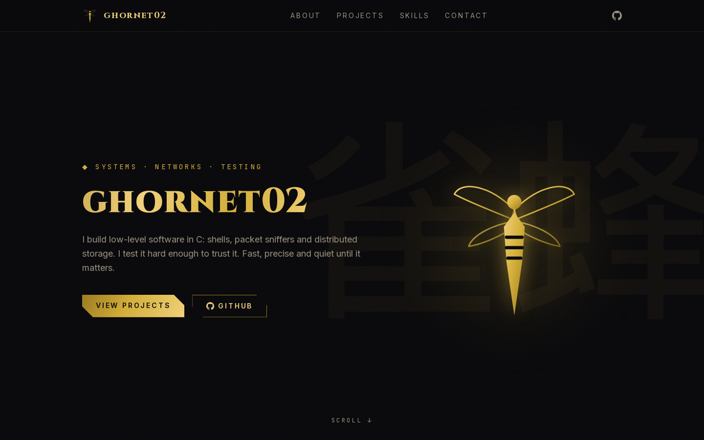

# ghornet02.github.io

My portfolio site, live at **https://ghornet02.github.io**.



A single-page site in black and gold, with a hornet (雀蜂) motif. It showcases these projects:

| Project | Description |
|---|---|
| [distributed-file-system](https://github.com/ghornet02/distributed-file-system) | Name server, storage servers and clients over TCP, with heartbeats, failover and end-to-end tests |
| [cshark](https://github.com/ghornet02/cshark) | Command-line packet sniffer and L2–L7 protocol analyser using libpcap |
| [c-shell](https://github.com/ghornet02/c-shell) | POSIX shell with its own lexer, parser, pipelines and job control |
| [software-testing](https://github.com/ghornet02/software-testing) | Black-box, integration and white-box pytest suites |

## Stack

- Next.js (App Router) with a static export
- Tailwind CSS
- Cinzel, Inter and JetBrains Mono via `next/font`
- Deployed to GitHub Pages by a GitHub Actions workflow on every push to `main`

## Develop

```sh
npm ci
npm run dev        # http://localhost:3000
npm run build      # static site in out/
```

Project content lives in `src/data/projects.ts`.
